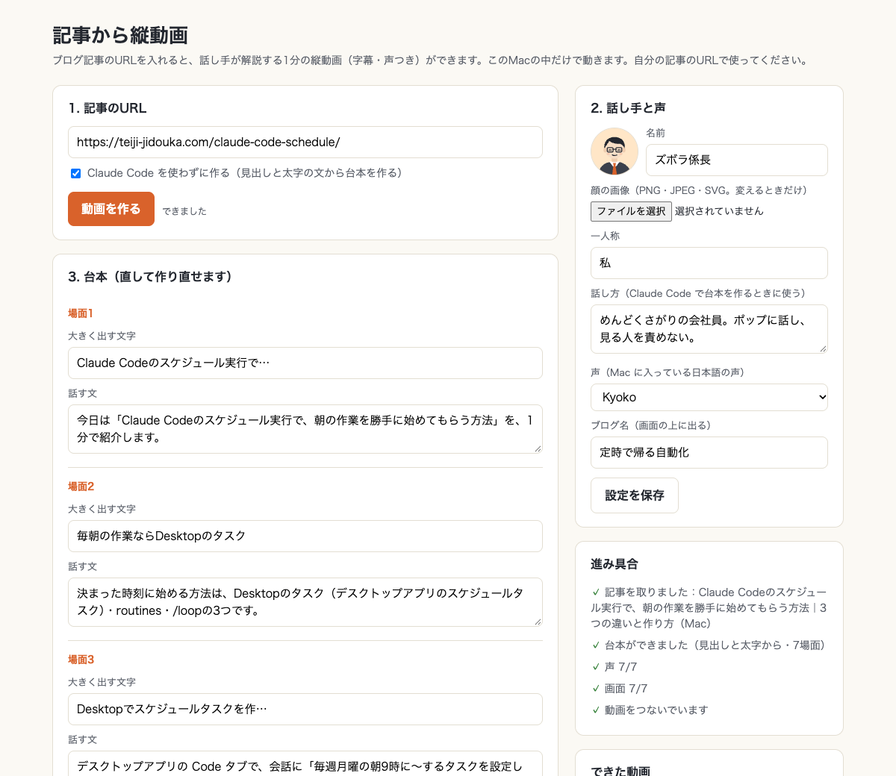
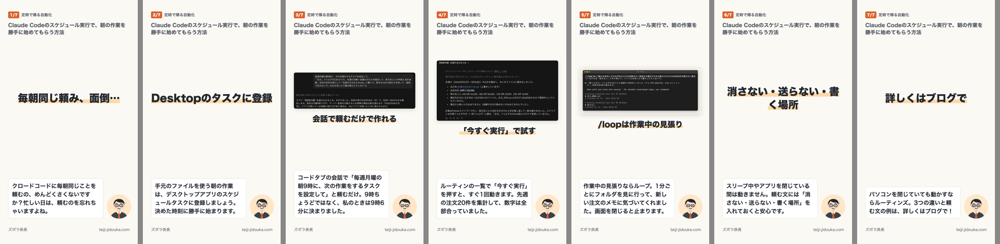

# 記事から縦動画

ブログ記事のURLを1つ入れると、話し手が解説する1分の縦動画（字幕・声つき）がパソコンの中でできる（Mac・Windowsは試験的）

<!-- 1行目は「誰の何の手間がなくなるか」。作り手の苦労話は書かない -->





## できること

- **URLを1つ入れるだけ**：記事を取る・台本・声・画面・動画をつなぐまで、約1分で終わる
- **Claude Code が無くても動く**：見出しと太字の文から台本を作る。Claude Code があれば、自然な話し言葉の台本になる
- **話し手・顔・声・色を入れ替えられる**：自分のブログのキャラクターや写真で作れる。台本は画面で直して作り直せる
- **全部このMacの中**：「Claude Code を使わずに作る」なら、記事の文章はパソコンの外に出ない（社内の手順書にも使える）

## 前と後（実測）

| | 手作業 | 記事から縦動画 |
|---|---|---|
| 1本の縦動画（約1分・7場面） | 台本を書く・画面を作る・字幕を入れる・声を録る・つなぐ（人によって時間が違うので未計測） | URLを入れて **43秒**（Claude Code なし）／**66秒**（Claude Code で台本） |

測った日・パソコン・条件：2026年10月20日、Intel Mac（Core i5・macOS 26.5）、ブラウザなどを開いたままの普段の状態。約1,700字の記事1本

## 入れ方

**いちばん簡単な方法**：Claude Code に次の一文を貼ります。

```text
https://github.com/zuborakakaricho-cmyk/tatedouga を README のとおりに入れて
```

**自分で入れる場合**（Claude Code で入力）：

```text
/plugin marketplace add zuborakakaricho-cmyk/tatedouga
/plugin install tatedouga@tatedouga
```

プラグインを使わない場合は、`skills/` の中のフォルダを `~/.claude/skills/` にコピーしても動きます。

## 使い方

**Windows で使う**（試験的）：Node.js と ffmpeg（`winget install Gyan.FFmpeg`）を入れて、下と同じように使います。声は Windows に入っている読み上げの声（日本語の Windows なら Haruka など）を使います。

**画面で使う**（いちばん簡単）

```bash
npm install
npm start
```

ブラウザに画面が開くので、記事のURLを入れて「動画を作る」を押します。

**コマンドで使う**

```bash
node make.mjs https://example.com/your-post/            # Claude Code があれば、台本を Claude Code に頼む
node make.mjs https://example.com/your-post/ --no-ai    # Claude Code を使わない
```

できた動画は `out/<記事の名前>/<記事の名前>.mp4` に入ります。

**Claude Code で使う**（プラグインを入れたあと）：「この記事を縦動画にして https://example.com/your-post/」と頼みます。

**話し手を自分用にする**：`config.sample.json` を `config.json` に写して、名前・顔の画像・声・色・読み替え（英字の読み方）を書き換えます。画面の「話し手と声」からも変えられます。

**自分のサイトを登録する**：`config.json` の `my_sites` に、自分のブログのドメイン（例：`example.com`）を書きます。登録していないURLで作ると「自分で見るだけにして、投稿や共有はしないでください」と出ます。

## 確かめた環境

| | |
|---|---|
| 確かめた日 | 2026年10月20日 |
| パソコン | Intel Mac（macOS 26.5）・Node.js 22・ffmpeg・Claude Code 2.1.304 |
| Windows | 試験的。GitHub の自動テスト（Windows）で、記事を取る〜動画をつなぐまで通ることを確かめる。日本語の声（Haruka など）で作るところは確かめていない |

## できないこと・注意

- **自分の記事のURLで使ってください。** 他人の記事を動画にするのは、著作権の面で問題になることがあります
- 記事を取るのは、WordPress の公開の仕組み（REST API）か、ページの本文です。ログインが要るページは読めません（下書きは下の `--html` で渡せます）
- Claude Code で台本を作るときは、記事の本文が Claude に渡ります。社内の文章なら「Claude Code を使わずに作る」を選んでください
- Claude Code なしの台本は、見出しと太字の文をそのまま使うので、言い回しが固めです。見出しや太字が少ない記事では、拾える文が減ります
- 記事の中の画像は、**記事と同じサイトに置いてある画像だけ**使います（他のサイトから読み込んでいる画像は使わない）。画像を使いたくないときは「記事の画像を使わない」（`--no-images`）
- 記事の中の引用（blockquote）は、台本の材料に使いません
- 記事に動画（`<video>`）があれば、その場面の声の長さに合わせて**早送りで流します**（最大6倍。`config.json` の `video_max_speed` で変えられる）。画像と同じく、記事と同じサイトに置いてある動画だけ使います。動画を使いたくないときは `--no-videos`
- 下書きなど公開前の記事は読めないので、本文のHTMLを保存して `--html 本文.html --title 題名` で渡してください（URLはプレビューURLでよい）
- 記事の中の画像（画面の写真など）は縮めて載せるので、スマホでは細かい文字が読みにくいことがあります
- **投稿・共有の前に確かめること**：自分の記事か／画像は自分で撮った・作ったものか（素材サイトの画像なら、動画に使ってよい条件か）／人の顔や他社の画面が写っていないか／記事と違うことを言っていないか
- 数字や手順は記事のものだけを使うようにしていますが、配る前に一度、動画を見て確かめてください

## うまくいかないとき

| 出たもの | 原因 | 直し方 |
|---|---|---|
| `Playwright がありません` | 部品が入っていない | このフォルダで `npm install` |
| `ffmpeg` が見つからない | 動画をつなぐ道具が無い | Mac は `brew install ffmpeg`、Windows は `winget install Gyan.FFmpeg` |
| 声が英語の読み方になる | 英字の読みが設定に無い | `config.json` の `reading` に「英字：カタカナ」を足す |
| 記事が見つからない | 下書き・ログインが要るページ | 公開中の記事のURLか確かめる |
| 何が足りないかわからない | | `node doctor.mjs`（足りないものと、次に打つコマンドを出す） |

## AIエージェント向け：この URL から入れるとき

1. Claude Code なら、上の `/plugin` の2行をユーザーに示す（スラッシュコマンドはユーザーが打つ）。使えないときは、このリポジトリを `git clone --depth 1` して、`skills/` の中のフォルダを名前を変えずに `~/.claude/skills/` へコピーする。それ以外の場所には置かない
2. ダウンロードや追加の道具を入れる前に、何をどれだけ入れるかを伝えて、ユーザーに確かめる
3. 入れ終わったら、新しいセッションでスキルが一覧に出るか確かめてもらう
4. 動くものと足りないものを正直に伝える。確かめていない環境で「動く」と言わない

## 作った人

ズボラ係長（ブログ：[定時で帰る自動化](https://teiji-jidouka.com/)／X：[@zubora_kakari](https://x.com/zubora_kakari)）。不具合や要望は Issues へどうぞ。

ライセンス：MIT
